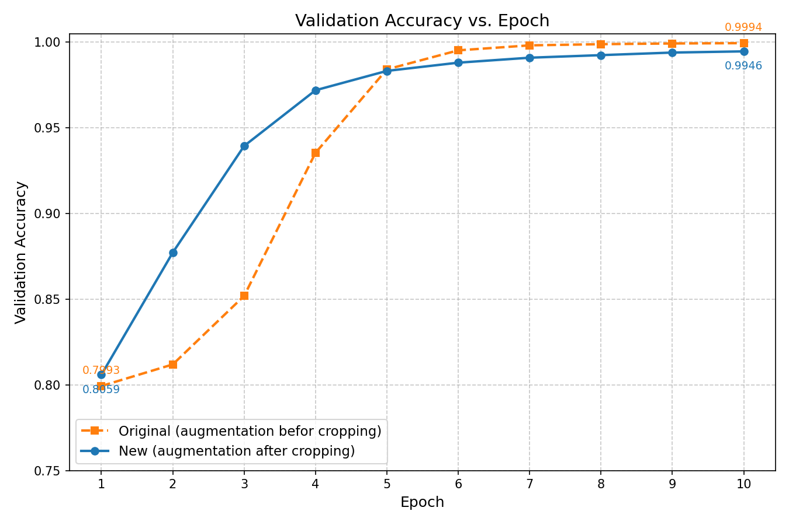

# Pi4B ONNX Sudoku

## Introduction

The dataset plays an important role in model training. This article presents an experiment on how two methods of synthetic data generation impact the accuracy of a trained model.

The original material for this experiment comes from the tutorial **"Deploy optimized ML models with ONNX Runtime on Arm platform"** on [https://learn.arm.com](https://learn.arm.com). The original experiment uses PyTorch to build a Neural Network Model and exports it to the ONNX format. This model is used to recognize digits 1 through 9 in a Sudoku game.

When synthesizing the dataset for training this model, the original experiment proposed a "solution-oriented" strategy. Since the model is meant to recognize digits in a Sudoku grid, it first downloads the solutions for synthetic Sudoku boards, renders photos of these completed boards, and then crops out each of the 9x9 = 81 cells into a 28x28 image for model training and validation. 

Meanwhile, to further simulate the effects of camera shake and blur in real-world photography, the original experiment also proposed applying jitter, perspective transformation, and Gaussian blur to the Sudoku solution image *before* cropping the 81 cells.

However, while reproducing the original experiment, the author found that training the model with the original synthetic dataset resulted in a severe misclassification of digit 6 as 9, which heavily impacted the model's ability to recognize and solve Sudoku puzzles. After improving the data synthesis approach from the original experiment, this severe misclassification issue disappeared.

All experiments in this article were conducted on a Raspberry Pi 4B. Interested readers can follow the installation guide below to reproduce the experimental results.

[Installation Guide](Installation.md)

## Experimental Results

Figure 1 and Figure 2 show the confusion matrices obtained by training the model with the datasets generated using the original data synthesis method and the improved method, respectively. It can be clearly observed that:
- In Figure 1, the correct detection probability for digit 6 is 0! Moreover, it has a 40% probability of being misclassified as digit 9.
- In Figure 2, the correct detection rate for every digit is close to 100%.

**Figure 1:**
```text
ONNX eval: 100%| 32/32 [00:24<00:00,  1.31it/s]
ONNX fp32 val acc: 0.9504
Confusion matrix (rows=true, cols=pred):
 [[12628     0     0     0     0     0     0     2     0     0]
 [    8   393     0    15     1     0     0     3     0     0]
 [    0    24   229    15    49     3     0     9     1     6]
 [    0     6     6   290     3    23     0     6     0     0]
 [    0     6    23     4   409     5     1     2     6     4]
 [    1     2     3    32     4   441     0     2     2     3]
 [    1     0    11     7    32    10    25     0    26   298]
 [    9     6     0     3     2     0     0   356     0     0]
 [    0     0     0     2     9    24     9     0   290     6]
 [    0     1    11     8    20    21     1     4     2   336]]
```

**Figure 2:**
```text
ONNX eval: 100%| 32/32 [00:24<00:00,  1.31it/s]
ONNX fp32 val acc: 0.9815
Confusion matrix (rows=true, cols=pred):
 [[12610     7     0     0     3     0     0     9     0     1]
 [    4   391     7     4     2     0     0    12     0     0]
 [    5     8   301    10     2     0     3     5     0     2]
 [    0     3     1   312     0     6     0     8     0     4]
 [    4    13     7     1   427     0     4     0     0     4]
 [    3     1     1    10     0   468     0     1     0     6]
 [    2     1     2     2     5     4   383     1     2     8]
 [    3     3     1     5     0     1     0   363     0     0]
 [    1     1     1    12     1     9     4     1   283    27]
 [    1     1     0    22     0     3     3     4     8   362]]
```

In the original data synthesis method, for each Sudoku solution, a clean image containing the 9x9=81 grid and digits is first generated with black lines on a white background. Then, jitter, perspective transformation, and Gaussian blur are applied to the entire image to simulate real-world photography. After that, the 9x9=81 cells are evenly cropped from the photo. However, because the original clean image undergoes perspective transformation *before* being evenly cropped, the resulting 81 cells end up containing the black border lines. These border lines interfere with model training, especially the recognition of the digit 6.

The improved data synthesis method instead first evenly crops the clean image into 81 cells, and then applies jitter, perspective transformation, and Gaussian blur to each individual cell. Although the digits within each cell may experience more severe distortion after the perspective transformation, the elimination of the black border line interference significantly improves model training and completely eliminates the misclassification of the digit 6.

In addition, the dataset size also impacts the model training results. In the previous experiments, the number of training images per digit was 1000. By doubling this number to 2000 and retraining, we plotted and compared the accuracy at each epoch (see Figure 3). It can be observed that only after 5 epochs did the accuracy under the original data synthesis method catch up with and consistently surpass that of the new data synthesis method. This indicates that the original "noisy" global augmentation acts as a strong regularization, requiring more data to fully realize its potential.

**Figure 3:** 



